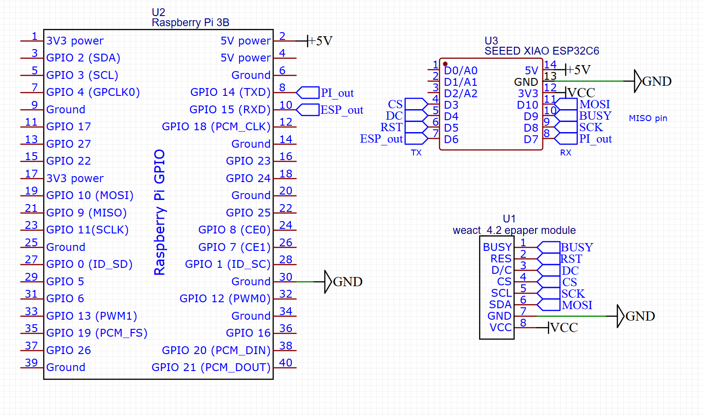
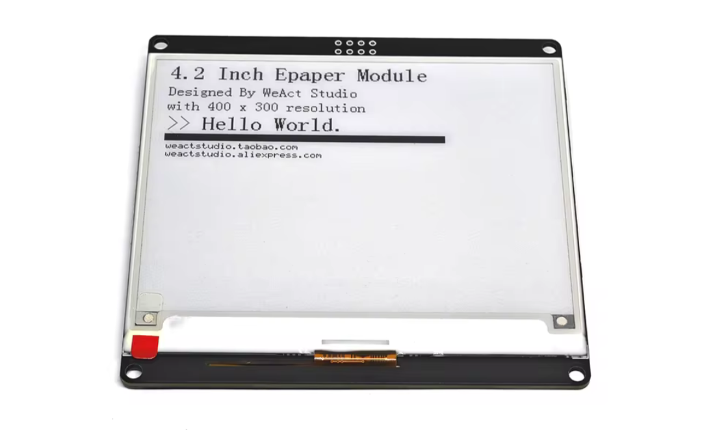
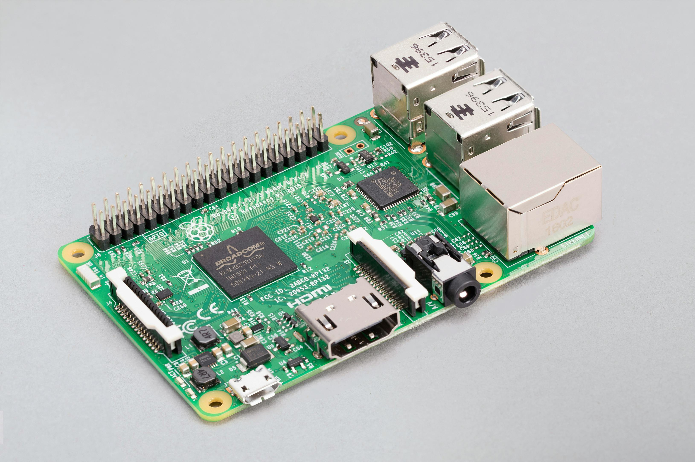

# SmartHome Dashboard

This is a project that will have an eink display - monochrome for best refresh rate. An MCU for low power things, and a SBC for running home assistant style things.

## Current Status

### Wiring Schematic

This is the current wiring shematic for everything. Power will be provided to the Pi's onboard port, with the ESP32 being wired up to the Pi's 5V pin.

Current Pinouts:
---
|ESP32 C6||
| - | - |
| D0 D1, D2 | empty |
| D3/21 | CS |
| D4/22 | DC |
| D5/23 | RST |
| D6/16 | TX |
| D7/17 | RX |
| D8/19 | SCK |
| D9/20 | BUSY |
| D10/18 | MOSI |

|Pi||
|-|-|
| 8/14 | TX (Connects to ESP RX) |
| 10/15 | RX (Connects ESP TX) |

### Display

Everything will be build around and for a 4.2" Black and White 400x300 E ink display

The one I have chosen is the AliExpress WeAct Eink bw display

### Raspberry Pi 3 B (1gb)

Will be using a Raspberry Pi 3 B 1gb, as it is the cheapest SBC that I can find that can run Home Assistant.

### Xiao ESP32 C6

Chosed for it's Zigbee/Thread capabilities, decent performance, and cheap-ish price.

## Project Info
### Rough Parts

- WeAct 4.2" epaper display
- Xiao ESP32 C6
- Raspberry Pi 3 B 1gb
- 64gb Micro SD card
- Power bank with passthrough and suitable wattage output
- USB Solar Panel

### Features

An E ink display for low power dashboard data. Will pair with a Sound Pad from week 3, recoded for controls. And will be used to automate fully the curtain opener project developed in weeks 1 and 2.

Will ideally be able to run both off grid and on grid, with the power bank acting as a ups style backup. Am going to acknowledge here that likely won't work purely on solar. But can hope...

### Possibly...
Originally wanted to make the solar panel track the sun, but the added cost for servos etc probably isn't worth it, especially as the panel likely won't be able to sustain the board indefinitely.

Also did find a decent looking 7.5" e ink panel on AliExpress for $25, but that was bwr, so would have a stupid long refresh rate. But could be good for people who don't want dynamically updating info.

Was also going to make a custom Battery system, but it ended up costing more - actually only about $5 above the limit (I spent way too long looking at Aliexpress). That would have involved battery charging boards etc, as well as MOSFETs to open or close charging and power paths.

Was also hoping to get a more powerful MCU, but the ESP32 S3 doesnt have Zigbee or Thread support, and the ESP32 S31 that does costs more than the Pi.

## BOM

| Item | Part Justification | Qty | Supplier | Cost/item | Total Cost | Link |
|---|---|---:|---|---:|---:|---|
| Raspberry Pi 3 B 1GB | Running home automations, e.g. Home Assistant | 1 | CEX | $27.00 | $27.00 | [CEX](https://uk.webuy.com/product-detail/?id=SDESRASPI3B&categoryName=SINGLE-BOARD-COMPUTERS&superCatName=COMPUTING&title=&queryID=C58AF310732152B5B0C69519774F00B6&position=1) |
| MicroSD Card | Storage | 1 | CEX | $13.40 | $13.40 | [CEX](https://uk.webuy.com/product-detail/?id=619659200473&categoryName=SECURE-DIGITAL-MICRO-(SD)&superCatName=ELECTRONICS&title=&queryID=F5EEC2FAB31FE256F851A8FE550AEB6F&position=7) |
| Solar Panel | Charging the battery, essentially providing power for everything | 1 | AliExpress | $13.58 | $13.58 | [AliExpress](https://www.aliexpress.com/item/1005009234699147.html?spm=a2g0n.productlist.0.0.6e2f3ec6aWSCOM&aff_platform=msite&m_page_id=&pdp_ext_f=%7B%22order%22%3A%226940%22%2C%22eval%22%3A%221%22%2C%22orig_sl_item_id%22%3A%221005009234699147%22%2C%22orig_item_id%22%3A%221005007613448154%22%2C%22fromPage%22%3A%22search%22%7D&pdp_npi=6%40dis%21USD%2113.58%216.51%21%21%2190.08%2143.17%21%400b88ab8a17931276627695103e0f01%2112000048417987242%21sea%21GB%218513385029%21ABX%211%210%21n_tag%3A-29910%3Bd%3A98c60280%3Bm03_new_user%3A-29895%3BpisId%3A5000000218644952&algo_pvid=356dd062-51d0-448e-94d1-3a89f7e60cfd&utparam-url=scene%3Asearch%7Cquery_from%3A%7Cx_object_id%3A1005009234699147%7C_p_origin_prod%3A1005007613448154) |
| 4.2" E Ink | Display | 1 | AliExpress | $24.86 | $24.86 | [AliExpress](https://www.aliexpress.com/item/1005007133350270.html?mp=1&pdp_npi=6%40dis%21USD%21USD+24.86%21USD+24.85%21%21USD+24.85%21%21%21%4021613be817931716421085626e0d7c%2112000039517565965%21ct%21GB%218513385029%21%211%210%21) |
| Xiao ESP32 C6 | Controlling the display | 1 | AliExpress | $9.12 | $9.12 | [AliExpress](https://www.aliexpress.com/item/1005007427033011.html?spm=a2g0o.cart.0.0.23e138daRROkyE&mp=1&pdp_npi=6%40dis%21USD%21USD+9.12%21USD+9.12%21%21USD+9.12%21%21%21%400b5e1a3817932764989705464e10bf%2112000040716079484%21ct%21GB%218513385029%21%211%210%21&pdp_ext_f=%7B%22cart2PdpParams%22%3A%7B%22pdpBusinessMode%22%3A%22retail%22%7D%7D) |
| USB WiFi Adapter | WiFi — as Pi 3's one is meant to be rubbish | 1 | AliExpress | $6.41 | $6.41 | [AliExpress](https://www.aliexpress.com/item/1005009475737233.html?spm=a2g0o.productlist.main.1.4c49f7f0R1gNyG&algo_pvid=5da80e1b-668c-4638-adfb-5073c73cf269&algo_exp_id=5da80e1b-668c-4638-adfb-5073c73cf269-0&pdp_ext_f=%7B%22order%22%3A%2252%22%2C%22eval%22%3A%221%22%2C%22fromPage%22%3A%22search%22%7D&pdp_npi=6%40dis%21USD%219.20%214.60%21%21%2160.96%2130.48%21%402103849717932990629812906e0ca4%2112000049216924296%21sea%21GB%218513385029%21ABX%211%210%21n_tag%3A-29910%3Bd%3A98ea16a6%3Bm03_new_user%3A-29895&curPageLogUid=LXqLOd6t4IpA&utparam-url=scene%3Asearch%7Cquery_from%3A%7Cx_object_id%3A1005009475737233%7C_p_origin_prod%3A) |
| Estimated total shipping | Shipping and tax for the whole order | 1 | — | $8.00 | $8.00 | — |
| **Grand Total** | | | | | **$102.37** | |

Shipping is just for CEX, as Aliexpress Choice automatically includes shipping in the price.